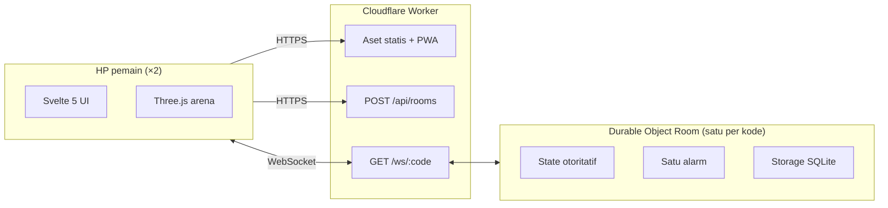

# Cerdas Amat

Game tarik tambang matematika realtime untuk 2 pemain. Kedua pemain beradu menjawab perkalian 1–9 × 1–9 dari HP masing-masing. Setiap jawaban benar menarik tali satu langkah, dan selisih 5 jawaban benar berarti KO.

**Main sekarang:** [cerdas-amat.radlabs.my.id](https://cerdas-amat.radlabs.my.id)

Tanpa akun, tanpa database, dan seluruhnya berjalan di plan gratis Cloudflare.

## Fitur

- **Room 2 pemain:** buat room, lalu bagikan kode 5 karakter atau link `?room=KODE` (Web Share API, dengan fallback ke clipboard).
- **Durasi 30/60/90/120 detik**, dipilih host. Pertandingan berakhir karena KO, waktu habis, WO, menyerah, atau batal.
- **Server otoritatif:** skor, posisi tali, fase, dan timer hanya ditentukan server, sehingga tali di kedua layar selalu sama.
- **Tahan putus koneksi:** reconnect otomatis, kursi lobby ditahan 60 detik, jeda 10 detik saat bermain (maksimal 3 kali per pemain), lalu menang WO.
- **5 karakter voxel** (kucing, beruang, rubah, panda, katak) dengan 5 pose, dirender realtime dengan Three.js. Tanpa WebGL, permainan memakai tali 2D.
- **PWA** yang bisa dipasang di layar utama HP; tampilan portrait, mobile-first.
- **Audio:** 2 musik latar dan 8 efek suara berlisensi CC0, dengan volume musik dan efek suara diatur terpisah.
- **Perlindungan dasar:** rate limit per IP, cek Origin, validasi skema setiap pesan, dan filter kata kasar pada nama.

## Arsitektur



- Satu Worker menyajikan client, membuat room, dan meneruskan WebSocket ke Durable Object `Room`, yang dinamai dari kode room (`idFromName(code)`).
- Seluruh logika permainan berjalan di Durable Object. Client mengecek jawaban secara lokal dan hanya mengirim jawaban yang benar. Tali digerakkan dari `score` pada pesan `tug` yang dikirim server.
- Hemat kuota: WebSocket Hibernation API, ping dijawab `setWebSocketAutoResponse`, tulis storage maksimal 1 kali per detik selama bermain, dan satu alarm untuk semua tenggat.

## Tech stack

| Lapisan  | Pilihan                                                                 |
| -------- | ----------------------------------------------------------------------- |
| Bahasa   | TypeScript                                                              |
| Client   | Svelte 5, Vite, Three.js, vite-plugin-pwa                               |
| Server   | Cloudflare Workers, Durable Objects (SQLite), WebSocket Hibernation API |
| Validasi | Valibot (skema dipakai bersama client dan server)                       |
| Tes      | Vitest, `@cloudflare/vitest-plugin`, Playwright                         |
| Monorepo | pnpm workspaces                                                         |
| CI/CD    | GitHub Actions + `cloudflare/wrangler-action`                           |

## Struktur repo

```text
cerdas-amat/
├─ apps/client/      Svelte + Three.js: layar, karakter voxel, audio, PWA
├─ apps/worker/      Worker + Durable Object Room
├─ packages/shared/  tipe pesan, skema Valibot, makeDeck, aturan hasil, filter nama, kode room
├─ e2e/              tes Playwright 2 pemain
├─ perf/             tes fps arena
└─ docs/             GDD, PRD, arsitektur, model data, dokumentasi fitur
```

## Menjalankan secara lokal

Prasyarat: Node.js 22 (lihat `.nvmrc`) dan pnpm 12 lewat Corepack.

```bash
corepack enable
pnpm install
pnpm dev
```

Buka `http://localhost:5173`. Vite meneruskan `/api` dan `/ws` ke `wrangler dev` di port 8787.

Untuk mencoba 2 pemain di satu komputer, buka pemain kedua di jendela incognito atau profil browser lain, karena token kursi disimpan di localStorage yang dipakai bersama semua tab.

## Perintah

| Perintah                    | Fungsi                                                                                        |
| --------------------------- | --------------------------------------------------------------------------------------------- |
| `pnpm dev`                  | Worker (port 8787) + Vite (port 5173)                                                         |
| `pnpm test`                 | Vitest di semua workspace; tes Worker berjalan di `workerd` lokal                             |
| `pnpm typecheck`            | `tsc` dan `svelte-check`                                                                      |
| `pnpm lint` / `pnpm format` | ESLint + cek Prettier / tulis format Prettier                                                 |
| `pnpm build`                | Build client, lalu `wrangler deploy --dry-run`                                                |
| `pnpm e2e`                  | Playwright 2 pemain (Chromium); pertama kali jalankan `pnpm exec playwright install chromium` |
| `pnpm perf`                 | fps arena 10 detik (360×740, DPR 2, CPU 6×); lolos jika rata-rata ≥ 30 fps                    |

## Deploy

| Lingkungan                             | Dideploy saat                                                                      |
| -------------------------------------- | ---------------------------------------------------------------------------------- |
| Preview (`workers.dev`)                | Setiap pull request ke `main`, setelah lint, typecheck, test, build, dan e2e lulus |
| Produksi (`cerdas-amat.radlabs.my.id`) | Merge ke `main`                                                                    |

Workflow membutuhkan secret repo `CLOUDFLARE_API_TOKEN` dan `CLOUDFLARE_ACCOUNT_ID`.

## Dokumentasi

- [Game Design Document](docs/initiate-file/cerdas-amat-gdd.md): aturan main dan alur layar
- [PRD Teknis](docs/initiate-file/cerdas-amat-prd.md): protokol pesan, model state, kuota, rencana fase
- [Arsitektur](docs/architecture.md) dan [model data](docs/data-model.md)
- [Dokumentasi fitur](docs/features/index.md)

## Kredit

Musik dan efek suara berlisensi CC0 dari Kenney dan OpenGameArt; rinciannya ada di [`apps/client/public/audio/CREDITS.md`](apps/client/public/audio/CREDITS.md).

Dibuat oleh [radLabs](https://radlabs.my.id).
