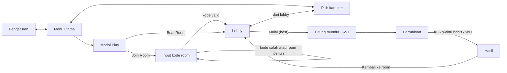

# Cerdas Amat — Game Design Document

Tanggal: 19 Oktober 2026

## Ringkasan konsep

Dua pemain beradu menjawab soal perkalian di perangkat masing-masing. Setiap jawaban benar menarik tali satu langkah ke arah penjawab, dan pemain yang unggul selisih 5 jawaban benar langsung menang.

- **Pemain:** 2 orang, perangkat terpisah, terhubung real-time lewat kode room.
- **Soal:** perkalian 1–9 × 1–9, acak dan terpisah untuk tiap pemain, tingkat kesulitan setara.
- **Durasi:** 30, 60, 90, 120 detik, atau tanpa batas, dipilih host. Tanpa batas berakhir lewat KO, WO, atau jika 2 menit tidak ada jawaban benar (dinilai dari selisih).
- **Menang:** KO saat selisih jawaban benar mencapai 5, unggul selisih saat waktu habis, atau WO jika lawan tidak tersambung kembali dalam 10 detik.
- **Seri:** waktu habis dengan penanda tali tepat di garis netral (selisih 0).
- **Karakter:** 5 karakter hewan bergaya blocky/voxel dengan desain orisinal.

## Alur layar

Semua jalur menuju lobby, dan setiap permainan kembali ke lobby.



Panah dua arah berarti layar tersebut punya tombol Back atau tutup ke asalnya. Layar pilih karakter bisa dibuka dari menu utama maupun dari lobby.

## Menu utama

Menu utama adalah layar pertama dan memuat tiga tombol: Play, Pengaturan, dan Pilih Karakter.

### Modal Pengaturan

- Slider volume **musik latar**.
- Slider volume **efek suara**.

### Modal Play

1. Modal menampilkan dua pilihan: **Buat Room** dan **Join Room**.
2. **Buat Room:** room langsung dibuat, pemain masuk ke lobby sebagai host.
3. **Join Room:** isi modal berganti menjadi input kode room.
    - Kode benar dan room masih kosong: pemain masuk ke lobby sebagai Player 2.
    - Kode salah atau room sudah penuh: pesan error tampil di modal yang sama, pemain bisa mencoba kode lain.

## Layar pilih karakter

Pilih karakter adalah layar tersendiri dengan isi yang sama, baik dibuka dari menu utama maupun dari lobby. Yang berbeda hanya tujuan tombol Back.

| Dibuka dari | Tombol Back kembali ke |
| --- | --- |
| Menu utama | Menu utama |
| Lobby | Lobby |

Tata letak dari atas ke bawah:

1. **Input nama:** terisi nama acak secara otomatis, bisa diganti pemain.
2. **Preview karakter:** karakter terpilih tampil full body, berputar 360° terus-menerus.
3. **Deretan avatar:** 5 avatar karakter untuk dipilih.

Aturan karakter:

- 5 karakter hewan bergaya blocky/voxel (tubuh kotak-kotak), desain orisinal: kucing, beruang, rubah, panda, dan katak.
- Kedua pemain boleh memilih karakter yang sama.
- Karakter dan nama bisa diganti sebelum masuk room dan di lobby, selama permainan belum dimulai.
- Setiap karakter dibuat menghadap satu arah; untuk Player 2 (sisi kanan) gambarnya dicerminkan.
- Setiap karakter punya 5 pose: Diam, Menarik, Terseret, Menang, Kalah. Preview di layar ini memakai pose Diam sambil berputar 360°; avatar dan slot lobby juga memakai pose Diam.

## Room dan lobby

Host membuat room dan membagikan kode unik ke Player 2. Setelah keduanya ada di lobby, host mengatur durasi lalu menekan Mulai.

### Isi lobby

- **Kode room:** kode unik yang dibagikan host ke Player 2.
- **Slot kiri (host):** avatar dan nama host.
- **Slot kanan (Player 2):** avatar dan nama Player 2; bertuliskan "Menunggu pemain..." selama belum ada yang bergabung.
- **Tombol pilih karakter:** membuka layar pilih karakter, Back kembali ke lobby.
- **Durasi (khusus host):** 30, 60, 90, 120 detik, atau tanpa batas (timer menampilkan ∞).
- **Tombol Mulai (khusus host):** aktif setelah Player 2 bergabung.

### Memulai permainan

1. Host menekan Mulai.
2. Kedua layar menampilkan hitung mundur 3-2-1.
3. Permainan dimulai serentak di kedua perangkat.

### Pemain keluar dari lobby

- **Host keluar:** Player 2 menjadi host, pindah ke slot kiri, dan room tetap memakai kode yang sama; slot kanan kosong menunggu pemain baru.
- **Player 2 keluar:** slot kanan kembali kosong ("Menunggu pemain..."); host tetap di room menunggu pemain lain dengan kode yang sama.

## Gameplay

Posisi tali ditentukan oleh selisih jawaban benar kedua pemain. Tiap jawaban benar menggeser tali 1 langkah, dan selisih 5 berarti KO.

### Soal

- Perkalian dua angka acak dari 1–9; hasil terbesar 81 (maksimal 2 digit).
- Total 81 soal; 3 × 4 dan 4 × 3 dihitung soal berbeda, tapi tidak boleh muncul berurutan.
- Soal tidak berulang sampai ke-81 soal terpakai.
- Tiap pemain mendapat soal sendiri dan menjawab tanpa menunggu lawan.
- Jawaban benar: tali bergeser, soal berikutnya langsung muncul.
- Jawaban salah: kolom jawaban dikosongkan, soal tetap sama sampai dijawab benar, tanpa penalti.

### Keypad

| Tombol | Fungsi |
| --- | --- |
| 0–9 | Mengisi angka jawaban |
| Hapus | Menghapus satu digit terakhir |
| AC | Mengosongkan seluruh jawaban |
| Enter | Mengirim jawaban |

Susunan ala keypad angka HP (1-2-3 di atas). Hapus dan Enter tampil sebagai ikon.

```
[ 1 ][ 2 ][ 3 ][ AC ]
[ 4 ][ 5 ][ 6 ][ AC ]
[ 7 ][ 8 ][ 9 ][ ⌫  ]
[      0      ][ ↵  ]
```

### Mekanik tali

Posisi tali = jumlah benar host − jumlah benar Player 2. Nilai positif berarti tali condong ke kiri (host), negatif ke kanan (Player 2).

- Setiap jawaban benar menggeser tali sejauh **1 langkah** ke arah penjawab. Ukuran langkah dan arena ada di PRD; langkah tidak terikat lebar karakter.
- Karakter yang unggul **diam di posisinya**; karakter yang tertinggal **terseret** mendekati zona netral sejauh selisihnya.
- Saat keunggulan berbalik, karakter yang terseret kembali ke posisi awal, lalu lawannya yang terseret.
- **KO** terjadi saat karakter yang tertinggal menyentuh zona netral, yaitu pada selisih 5.
- Karena itu, jarak tangan tiap karakter ke zona netral di arena = 5 langkah.

| Kondisi | Hasil |
| --- | --- |
| Selisih mencapai +5 | Host menang KO, permainan langsung berhenti |
| Selisih mencapai −5 | Player 2 menang KO, permainan langsung berhenti |
| Waktu habis, selisih > 0 | Host menang |
| Waktu habis, selisih < 0 | Player 2 menang |
| Waktu habis, selisih = 0 | Seri |

Contoh: skor 12 vs 9 (selisih 3) belum KO; skor 14 vs 9 (selisih 5) sudah KO.

### Pemain terputus

1. Permainan dan waktu dijeda; layar pemain yang tersisa menampilkan hitung mundur 10 detik.
2. Pemain tersambung kembali dalam 10 detik: permainan dan waktu berlanjut.
3. Tidak tersambung: pemain yang tersisa menang WO.

## Tampilan arena

Kedua layar menampilkan arena yang sama dan sinkron: host di kiri, Player 2 di kanan, dengan tali di antara keduanya.

- **Karakter:** dua karakter full body dalam pose menarik tali, host di kiri dan Player 2 di kanan (dicerminkan), tangan masing-masing berjarak 5 langkah dari zona netral.
- **Nama:** tampil di atas kepala masing-masing karakter, agar tetap bisa dibedakan jika memakai karakter yang sama.
- **Zona netral:** garis vertikal tebal semi-transparan di tengah arena; posisinya tetap.
- **Penanda tali:** garis vertikal tipis di tengah tali; bergeser 1 langkah per jawaban benar, dan karakter yang tertinggal ikut terseret.
- **Soal dan kolom jawaban:** soal milik pemain itu sendiri beserta jawaban yang sedang diketik.
- **Keypad:** ala keypad angka HP (lihat Gameplay).
- **Waktu:** sisa durasi permainan.
- **Sinkronisasi:** posisi tali di kedua perangkat harus selalu sama.

## Layar hasil

Setelah KO, waktu habis, atau WO, tiap layar menampilkan hasil dari sudut pandang pemainnya.

- **Teks utama:** "Kamu Menang", "Kamu Kalah", "Seri", atau "Dibatalkan" (kedua pemain terputus).
- **Keterangan:** KO, Waktu habis, Menang WO / Kalah WO (putus koneksi), Lawan menyerah / Kamu menyerah (menekan Keluar), atau Kedua pemain terputus.
- **Skor:** jumlah jawaban benar kedua pemain.
- **Karakter:** pemenang dengan pose Menang, yang kalah dengan pose Kalah; saat seri keduanya pose Diam.
- Tombol **Kembali ke room** membawa kedua pemain ke lobby room yang sama.
- Di lobby, host bisa mengubah durasi lalu memulai permainan lagi.

## Audio

Game memakai 2 musik latar dan 8 efek suara; volume keduanya diatur terpisah di modal Pengaturan.

- **Musik latar:** satu lagu untuk menu utama dan lobby, satu lagu untuk permainan.
- **Efek suara:** tekan tombol keypad, jawaban benar, jawaban salah, tali tertarik, hitung mundur, menang, kalah, dan seri.
