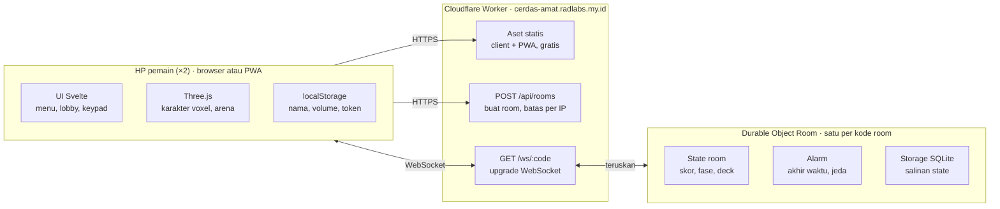

# Tarik Tambang Matematika — PRD Teknis

Tanggal: 19 Oktober 2026 · Penulis: Radityo Dwiki

## Ringkasan dan lingkup

Tarik Tambang Matematika adalah game web 2 pemain realtime di cerdas-amat.radlabs.my.id: pemain beradu menjawab perkalian 1–9 × 1–9, dan selisih 5 jawaban benar berarti KO. Seluruh sistem berjalan di plan gratis Cloudflare, tanpa akun dan tanpa database. Dokumen ini melengkapi GDD (aturan main dan alur layar) dengan detail teknis untuk membangunnya.

**Masuk v1:**

- Buat room, join lewat kode atau link, lobby, permainan, hasil, kembali ke room.
- 5 karakter voxel dengan 5 pose (Diam, Menarik, Terseret, Menang, Kalah), sesuai preview yang disetujui 19 Oktober 2026.
- Reconnect otomatis, jeda 10 detik saat bermain, dan menang WO.
- PWA yang bisa dipasang di layar utama HP.
- Audio: 2 musik latar dan 8 efek suara, volume diatur terpisah.

**Tidak masuk v1:** akun, riwayat permainan, leaderboard, matchmaking acak, lawan bot, bahasa selain Indonesia, lebih dari 2 pemain per room, dan mode offline.

## Keputusan produk

Semua keputusan di bawah sudah final dari diskusi 19 Oktober 2026; bagian teknis berikutnya mengikuti tabel ini.

| No | Topik | Keputusan |
| --- | --- | --- |
| 1 | Target pemain | Publik |
| 2 | Platform | Web mobile-first, bisa dipasang sebagai PWA |
| 3 | Orientasi layar | Portrait |
| 4 | Karakter | Voxel dari data kode, dirender realtime dengan Three.js; model dari preview yang disetujui |
| 5 | Data | Tanpa akun dan tanpa database |
| 6 | Soal | Urutan acak terpisah per pemain; semua soal 1 digit × 1 digit dianggap setara |
| 7 | Soal habis | 81 soal diacak ulang |
| 8 | Putus di lobby | Keluar hanya lewat tombol; terputus = slot ditahan 60 detik; ada tombol Bagikan dan link `?room=KODE` |
| 9 | Putus saat bermain | Tombol keluar = menyerah (WO langsung); putus = jeda 10 detik; maks 3 jeda per pemain; dua pemain putus lebih dari 10 detik = batal |
| 10 | Setelah hasil | Room tetap hidup; pemain yang tidak kembali ke lobby dalam 30 detik slotnya dikosongkan |
| 11 | Kode room | 5 karakter tanpa 0, O, 1, I, L; tidak peka huruf besar-kecil; room dihapus setelah kosong 5 menit |
| 12 | Nama pemain | Maks 12 karakter, dengan filter kata kasar |
| 13 | Proporsi karakter | Chibi, kepala sekitar 44% tinggi badan |
| 14 | Ciri hewan | Kucing abu belang berkalung oranye, beruang cokelat, rubah oranye, panda, katak hijau |
| 15 | Pose | Diam, Menarik, Terseret, Menang, Kalah; "Putar" = pose Diam + rotasi badan 360° terus-menerus, khusus layar pilih karakter |
| 16 | Langkah tali | Arena logis 12 langkah; kamera menampilkan 13,6 langkah, jadi 1 langkah = lebar canvas / 13,6; tidak terikat lebar karakter |
| 17 | Penyalahgunaan | Batas buat room dan batas kode salah per IP; tanpa batas kiriman jawaban |
| 18 | Kuota habis | Pesan "Server sedang penuh, coba lagi setelah pukul 07.00 WIB" |
| 19 | Domain | cerdas-amat.radlabs.my.id |
| 20 | Bahasa | Indonesia; semua teks di satu file |
| 21 | Audio | Aset berlisensi CC0 (Kenney, OpenGameArt) |
| 22 | Hosting | Cloudflare Workers + Durable Objects, plan gratis |

## Arsitektur dan stack

Satu Cloudflare Worker menyajikan client, membuat room, dan meneruskan WebSocket ke Durable Object milik room itu; seluruh logika permainan berjalan di Durable Object.



Klik di HP hanya menjadi pesan; keputusan skor, tali, dan waktu diambil di Durable Object, lalu dikirim balik ke kedua HP lewat WebSocket yang sama.

| Lapisan | Pilihan | Alasan |
| --- | --- | --- |
| UI client | Svelte 5 + Vite + TypeScript | Ringan untuk menu, lobby, dan keypad; bundel kecil untuk HP murah |
| 3D | Three.js | Sudah dipakai di preview karakter; `InstancedMesh` cukup untuk voxel |
| Server | Cloudflare Workers + Durable Objects, TypeScript | Satu room = satu objek dengan state sendiri; gratis, tanpa server untuk dirawat |
| Realtime | WebSocket Hibernation API | Room yang diam tidak dihitung durasinya |
| Validasi pesan | Valibot | Skema dipakai bersama client dan server, ukurannya kecil |
| PWA | vite-plugin-pwa | Manifest dan service worker dibuat dari konfigurasi build |
| Tes | Vitest, `@cloudflare/vitest-plugin`, Playwright | Unit, Durable Object, dan end-to-end |
| Monorepo | pnpm workspaces | Tipe dan aturan main dibagi tanpa menerbitkan paket |

```text
cerdas-amat/
├─ apps/client/      Svelte + Three.js: layar, karakter, audio
├─ apps/worker/      Worker + Durable Object Room
└─ packages/shared/  tipe pesan, skema, makeDeck, aturan hasil, filter nama
```

## Model state room

Server adalah satu-satunya pemegang keputusan: skor, posisi tali, fase, dan timer hanya diubah oleh Durable Object room. Client mengirim input dan menggambar state yang diterima.

```ts
type Phase = 'lobby' | 'countdown' | 'playing' | 'paused' | 'result';
type SeatIndex = 0 | 1; // 0 = host (kiri), 1 = Player 2 (kanan)

interface Seat {
  token: string;          // rahasia 128-bit, untuk klaim ulang kursi
  name: string;           // maks 12 karakter, sudah lolos filter
  character: 'kucing' | 'beruang' | 'rubah' | 'panda' | 'katak';
  connected: boolean;
  disconnectedAt?: number;
  inLobby: boolean;       // false selama masih di layar hasil
  pausesUsed: number;     // maks 3 per pertandingan
}

interface RoomState {
  code: string;
  phase: Phase;
  seats: [Seat | null, Seat | null];
  durationSec: 30 | 60 | 90 | 120;
  score: [number, number];        // posisi tali = score[0] - score[1]
  qIndex: [number, number];       // nomor soal aktif per pemain
  decks: [[number, number][], [number, number][]];
  startsAt?: number;              // akhir hitung mundur (epoch ms)
  endsAt?: number;                // akhir permainan (epoch ms)
  remainingMs?: number;           // sisa waktu saat jeda
  pause?: { seat: SeatIndex; until: number };
  result?: { winner: SeatIndex | null; reason: 'ko' | 'time' | 'wo' | 'void' };
  emptySince?: number;
}
```

**Aturan otoritas:**

1. Jawaban diterima hanya jika fase `playing`, nomor soal sama dengan `qIndex` pemain itu, dan nilainya benar.
2. Durable Object memproses pesan satu per satu. Dua jawaban yang hampir bersamaan di selisih 4 tetap punya urutan pasti: yang pertama sampai menutup permainan, yang kedua ditolak karena fase sudah `result`.
3. Timer disimpan sebagai `endsAt`. Client menghitung sisa waktu dari `endsAt` ditambah selisih jamnya dengan server. Akhir waktu dipicu oleh Alarm Durable Object, bukan oleh client.
4. Jawaban salah tidak dikirim ke server, karena tidak berpengaruh ke skor. Ini juga menghemat kuota.

**Persistensi:** Durable Object bisa dikeluarkan dari memori saat diam, jadi state disalin ke storage-nya setiap kali state lobby berubah (join, keluar, ganti profil, durasi, terputus) dan saat fase berubah, serta paling sering 1 kali per detik selama bermain. Perubahan lobby jarang, jadi kuota tulis tetap aman. Identitas kursi tiap koneksi (`{ seat, invalid }`: kursi dan jumlah pesan tidak valid) disimpan dengan `serializeAttachment` di WebSocket dan ikut diperbarui saat Player 2 pindah ke kursi 0, yang tidak memakai kuota tulis storage. Room dihapus total (`deleteAll`) setelah kosong 5 menit.

## Protokol pesan

Client dan server bertukar pesan JSON lewat satu WebSocket per pemain; tipe semua pesan ada di `packages/shared` dan divalidasi skema di server. Pesan lebih dari 1 KB atau tidak valid dibalas `error INVALID_MESSAGE`; koneksi ditutup dengan close code `4400` setelah 5 pesan tidak valid.

**Close code aplikasi:** `4400` (pesan tidak valid), `4404` (room tidak ditemukan), `4409` (room penuh). Client berhenti mencoba tersambung ulang saat menerima salah satunya.

**Endpoint HTTP:**

| Endpoint | Fungsi | Balasan |
| --- | --- | --- |
| `POST /api/rooms` | Membuat room baru | `200 { code }`; 503 `{ error: "TRY_AGAIN" }` jika 5 kode acak bentrok; 429 jika melewati batas |
| `GET /ws/:code` | Upgrade ke WebSocket room | 101; 404 jika format kode tidak sah (DO tidak dipanggil); 426 tanpa header `Upgrade`. Room yang tidak ada tetap 101, lalu `error ROOM_NOT_FOUND` dan close `4404`, karena browser tidak bisa membaca status HTTP dari upgrade yang gagal |

**Client ke server:**

| Pesan | Isi | Boleh saat |
| --- | --- | --- |
| `hello` | `token?`, `name`, `character` | Pertama setelah tersambung |
| `setProfile` | `name`, `character` | `lobby` |
| `setDuration` | `sec`: 30, 60, 90, atau 120 | `lobby`, khusus host |
| `start` | – | `lobby`, khusus host, kedua kursi terisi dan ada di lobby |
| `answer` | `q` (nomor soal), `value` | `playing` |
| `backToRoom` | – | `result` atau `lobby` |
| `leave` | – | Kapan saja; saat `playing` atau `paused` berarti menyerah |
| `sync` | `t` (jam client) | Kapan saja, untuk menghitung selisih jam |

**Server ke client:**

| Pesan | Isi | Dikirim saat |
| --- | --- | --- |
| `welcome` | `seat`, `token`, `room`, `serverNow` | Setelah `hello` diterima |
| `room` | `room` (snapshot `{ code, phase, durationSec, seats }`, tiap kursi `{ name, character, connected, inLobby }`, tanpa token dan deck) dan `seat` (kursi penerima saat ini) | Setiap perubahan di lobby |
| `countdown` | `startsAt` | Host menekan Mulai |
| `deck` | `from`, `questions` (162 soal) | Saat hitung mundur; disambung jika soal hampir habis |
| `tug` | `score`, `by` | Setiap jawaban benar diterima |
| `reject` | `q` | Jawaban ditolak (nomor soal kedaluwarsa) |
| `pause` | `seat`, `until`, `remainingMs` | Pemain terputus saat bermain |
| `resume` | `endsAt` | Pemain kembali dalam 10 detik |
| `result` | `winner`, `reason`, `score` | KO, waktu habis, WO, atau batal |
| `error` | `code`, `message` | `ROOM_NOT_FOUND`, `ROOM_FULL`, `NOT_HOST`, `INVALID_MESSAGE`, `RATE_LIMITED`, `QUOTA` |
| `sync` | `t`, `serverNow` | Balasan `sync` |

Deck dikirim 162 soal sekaligus (dua kali 81, sambungannya tetap mematuhi aturan berurutan) supaya client bisa menampilkan soal berikutnya tanpa menunggu jaringan. Kalau pemain melewati soal ke-150, server mengirim 81 soal lanjutan.

**Heartbeat:** client mengirim teks `ping` tiap 5 detik. Server menjawabnya lewat `setWebSocketAutoResponse` tanpa membangunkan Durable Object, lalu memeriksa `getWebSocketAutoResponseTimestamp` di alarm. Pemain tanpa ping 12 detik dianggap terputus, walau socket belum ditutup oleh browser.

## Room, lobby, dan reconnect

Satu room = satu Durable Object yang dinamai dari kodenya (`idFromName(code)`), jadi kode langsung menunjuk ke room tanpa tabel pencarian.

**Kode room:** 5 karakter dari 31 simbol `ABCDEFGHJKMNPQRSTUVWXYZ23456789`, sekitar 28,6 juta kombinasi. Input diubah ke huruf besar. Saat membuat room, Worker mengacak kode lalu memanggil `init()` di Durable Object; kalau kode itu sedang dipakai, Worker mengacak ulang (maks 5 kali).

**Membuat dan bergabung:**

1. Buat Room: `POST /api/rooms` mengembalikan kode, client membuka `/ws/:code`, mengirim `hello`, dan mendapat kursi 0 (host).
2. Join Room: lewat input kode atau link `https://cerdas-amat.radlabs.my.id/?room=KODE`. Room kosong di kursi 1 memberi kursi itu; room penuh membalas `ROOM_FULL` lalu close `4409`; Durable Object yang belum pernah di-`init()` membalas `ROOM_NOT_FOUND` lalu close `4404`, tanpa menyimpan apa pun.
3. Tombol Bagikan memakai Web Share API dengan link room; browser tanpa Web Share menyalin link ke clipboard.

**Token kursi:** `welcome` membawa token 128-bit (`crypto.randomUUID()`). Client menyimpannya di localStorage per kode room. Koneksi baru yang mengirim token yang cocok mengambil kembali kursi itu, sekalipun koneksi lama belum ditutup.

**Keluar dan terputus di lobby:**

| Kejadian | Hasil |
| --- | --- |
| Host menekan Keluar | Player 2 pindah ke kursi 0 dan menjadi host; kursi 1 kosong; kode tetap |
| Player 2 menekan Keluar | Kursi 1 kosong ("Menunggu pemain...") |
| Pemain terputus | Slot tetap, tertulis "Terputus..."; kursi ditahan 60 detik |
| Tidak kembali dalam 60 detik | Diperlakukan sama seperti menekan Keluar |
| Kedua kursi kosong | `emptySince` dicatat; setelah 5 menit room dihapus dan kode bebas |

**Reconnect di client:** saat socket tertutup, client mencoba lagi setelah 0,5, 1, 2, lalu tiap 4 detik. Saat halaman kembali terlihat (`visibilitychange`), client langsung mencoba tanpa menunggu jadwal. Ini menangani kasus host membagikan kode lewat WhatsApp lalu kembali.

**Kembali dari layar hasil:** fase room pindah ke `lobby` saat pemain pertama menekan Kembali ke room. Pemain yang belum menekan tampil "Melihat hasil..." di slotnya, dan tombol Mulai baru aktif setelah keduanya ada di lobby. Pemain yang tidak menekan dalam 30 detik dikeluarkan; kalau itu host, pemain di lobby menjadi host.

## Gameplay dan sinkronisasi

Permainan berjalan di empat fase server: `countdown`, `playing`, `paused`, dan `result`; semua perpindahan dipicu pesan pemain atau Alarm Durable Object.

**Hitung mundur:** host menekan Mulai, server menetapkan `startsAt = sekarang + 3000 ms`, mengirim `countdown` dan `deck` ke tiap pemain, lalu memasang alarm di `startsAt`. Saat alarm berbunyi, fase menjadi `playing` dan `endsAt = startsAt + durasi`. Pemain yang terputus selama hitung mundur membatalkan permainan dan room kembali ke lobby.

**Soal:** fungsi `makeDeck(prev)` di `packages/shared` mengacak 81 pasangan (a, b) dengan a dan b dari 1 sampai 9. Hasil acak ditolak dan diacak ulang jika ada dua soal berurutan yang merupakan pasangan tukar (3 × 4 lalu 4 × 3), atau jika soal pertama deck baru sama atau pasangan tukar dari soal terakhir deck sebelumnya. Tiap pemain mendapat deck sendiri.

**Alur jawaban:**

1. Client mencocokkan jawaban dengan soal lokal. Salah: kolom dikosongkan dan soal tetap, tanpa pesan ke server.
2. Benar: client langsung menampilkan soal berikutnya, lalu mengirim `answer { q, value }`.
3. Server memeriksa fase, nomor soal, dan nilai. Lolos: `qIndex` dan skor pemain itu naik 1, lalu `tug` dikirim ke kedua pemain.
4. Kedua client menggerakkan tali dari `score` di pesan `tug`, bukan dari hitungan sendiri, jadi posisi tali di kedua layar selalu sama.
5. Selisih skor mencapai 5: server langsung mengirim `result` dengan alasan `ko`.

**Akhir waktu:** alarm di `endsAt` menutup permainan dengan alasan `time`. Selisih positif = host menang, negatif = Player 2 menang, nol = seri. Client menampilkan sisa waktu dari `endsAt` dan selisih jam hasil `sync`, sehingga timer di kedua HP sama walau jam HP berbeda.

**Jeda karena putus koneksi:**

| Kejadian | Hasil |
| --- | --- |
| Pemain terputus, jeda yang dipakai di bawah 3 | Fase `paused`; `remainingMs` disimpan; keypad kedua pemain dikunci; hitung mundur 10 detik di layar lawan |
| Kembali dalam 10 detik | Fase `playing`; `endsAt = sekarang + remainingMs`; `resume` dikirim |
| Tidak kembali dalam 10 detik | Lawan menang WO |
| Terputus keempat kalinya | Lawan langsung menang WO, tanpa jeda |
| Kedua pemain terputus lebih dari 10 detik | Hasil `void` (batal), tanpa pemenang |
| Menekan Keluar saat bermain atau jeda | Menyerah; lawan langsung menang WO |

**Satu alarm untuk semuanya:** Durable Object hanya punya satu alarm, jadi server selalu memasang alarm ke waktu terdekat dari `startsAt`, `endsAt`, `pause.until`, cek heartbeat (tiap 5 detik selama bermain), batas 60 detik kursi lobby, batas 30 detik layar hasil, dan batas 5 menit room kosong. Setiap alarm memproses semua tenggat yang sudah lewat, lalu memasang alarm berikutnya.

## Client

Client adalah single-page app Svelte dengan satu canvas WebGL bersama; layar berganti lewat state aplikasi, dan URL hanya membawa `?room=KODE`.

**Layar dan komponen:**

| Komponen | Isi | Catatan |
| --- | --- | --- |
| `MenuUtama` | Play, Pengaturan, Pilih Karakter | Membaca `?room=` dan langsung membuka Join |
| `ModalPengaturan` | Slider musik dan efek suara | Nilai disimpan di localStorage |
| `ModalPlay` | Buat Room, Join Room, input kode | Error kode tampil di modal yang sama |
| `PilihKarakter` | Input nama, preview berputar, 5 avatar | Back kembali ke asal (menu atau lobby) |
| `Lobby` | Kode, Bagikan, 2 slot, durasi, Mulai | Durasi dan Mulai hanya untuk host |
| `Permainan` | HUD, arena, soal, keypad | Keypad dikunci saat jeda; keyboard fisik juga didukung |
| `Hasil` | Teks hasil, alasan, skor, kedua karakter | Pose Menang dan Kalah; saat seri kedua karakter memakai pose Diam |

**Rendering voxel:**

- Data 5 karakter dipindah dari preview yang disetujui ke `apps/client/src/characters/`, satu file per hewan, berisi peta voxel per bagian tubuh.
- Tiap bagian tubuh jadi satu `InstancedMesh`; titik putar di leher, bahu, dan pinggul; animasi dihitung dari kode.
- Satu `WebGLRenderer` dipakai bergantian oleh layar pilih karakter, arena, dan hasil, karena HP membatasi jumlah konteks WebGL.
- Gambar 5 avatar dirender sekali saat aplikasi dibuka, lalu dipakai sebagai gambar biasa.
- Arena logis = 12 langkah: 5 langkah dari tangan tiap karakter ke zona netral, ditambah sekitar 1 langkah badan tiap karakter. Kamera ortografis menampilkan 13,6 langkah (margin 0,8 langkah di tiap sisi), jadi di layar 1 langkah = lebar canvas / 13,6. Ikuti implementasi preview: `STEP = 6`, `VIEW_W = 13.6 * STEP`, tangan mulai di `±5 * STEP`.
- Karakter digambar sekitar 1,5 langkah lebarnya dan boleh melewati batas langkah; ukuran model tidak memengaruhi jarak tali.
- Pose Diam dipakai di mode Putar, thumbnail avatar, slot karakter di lobby, dan layar hasil saat seri. Di arena selama bermain: Menarik saat unggul atau seri, Terseret saat tertinggal.
- `devicePixelRatio` dibatasi 2. Target: 60 fps di HP kelas menengah dan minimal 30 fps di HP Android kelas bawah.

**Audio:** Web Audio API lewat wrapper kecil, dengan file MP3 supaya jalan di semua browser. Suara baru bisa diputar setelah ketukan pertama pemain (aturan autoplay browser), jadi audio dibuka di tombol pertama yang ditekan di menu utama.

**PWA:** `vite-plugin-pwa` membuat manifest (`display: standalone`, `orientation: portrait`, ikon 192 dan 512 px) dan service worker yang menyimpan aset di cache. Game tetap butuh internet; tanpa koneksi, menu utama menampilkan "Butuh koneksi internet untuk bermain".

**Penyimpanan lokal:** nama, karakter, volume musik dan efek suara, serta token kursi per kode room. Semua teks antarmuka ada di `apps/client/src/i18n/id.ts`. Font di-host sendiri bersama aset supaya tidak bergantung pada server lain.

## Keamanan dan batas penyalahgunaan

Pembatasan dipasang di dua titik yang rawan disalahgunakan: membuat room dan menebak kode. Kiriman jawaban tidak dibatasi, sesuai keputusan nomor 17.

| Batas | Nilai | Saat terlewati |
| --- | --- | --- |
| Membuat room | 20 per 60 detik per IP | `POST /api/rooms` membalas 429; client menampilkan "Terlalu banyak room dibuat, coba lagi sebentar lagi" |
| Join dengan kode salah | 30 per 60 detik per IP | `RATE_LIMITED`; input kode dikunci 60 detik |

Batasnya sengaja longgar karena satu sekolah atau satu jaringan seluler sering berbagi satu IP; dengan 28,6 juta kombinasi, 30 tebakan per menit tidak berarti apa-apa bagi penebak. Batas dihitung dengan binding Rate Limiting di Worker ([dokumentasi](https://developers.cloudflare.com/workers/runtime-apis/bindings/rate-limit/)), yang hanya mendukung periode 10 atau 60 detik dan dihitung per lokasi Cloudflare. Ketersediaannya di plan gratis dicek di Fase 0; kalau tidak tersedia, penghitung disimpan di memori Durable Object khusus pembatas.

**Validasi dan identitas:**

- Setiap pesan divalidasi skema di server; fase dan kursi pengirim dicek untuk setiap aksi (misalnya `start` dan `setDuration` hanya dari kursi 0).
- Upgrade WebSocket hanya diterima dari Origin `https://cerdas-amat.radlabs.my.id` (dan origin preview).
- Token kursi tidak pernah ikut dalam snapshot `room` yang dikirim ke pemain lain.

**Filter nama:** nama dinormalisasi (huruf kecil, `4→a`, `1→i`, `0→o`, `3→e`, `5→s`, spasi dan tanda baca dibuang), lalu dicocokkan dengan daftar kata kasar Indonesia dan Inggris sebagai potongan kata. Nama yang tertolak diganti nama acak. Filter jalan di client untuk umpan balik cepat dan di server sebagai penentu.

**Data pribadi:** tidak ada yang disimpan permanen. Nama dan karakter hanya hidup di storage room dan hilang saat room dihapus.

## Kuota gratis Cloudflare

Plan gratis cukup untuk sekitar 600–700 pertandingan per hari; yang membatasi adalah durasi aktif Durable Object, bukan jumlah pesan. Kalau kuota habis, tidak ada tagihan: operasi gagal sampai reset pukul 00:00 UTC (07:00 WIB) ([harga Durable Objects](https://developers.cloudflare.com/durable-objects/platform/pricing)).

| Kuota (perkiraan) | Per hari | Pemakaian per pertandingan |
| --- | --- | --- |
| Request Durable Object | sekitar 100.000 | 2 koneksi + jawaban benar (20 pesan masuk = 1 request) |
| Durasi Durable Object | sekitar 13.000 GB-detik | sekitar 2,5 menit aktif × 128 MB ≈ 19 GB-detik |
| Request Worker | 100.000 | 1 buat room + 2 upgrade WebSocket; aset statis gratis |
| Baris ditulis ke storage | sekitar 100.000 | Perubahan fase + maks 1 per detik selama bermain |

Angka harian dibagi dari kuota bulanan Durable Objects plan gratis (sekitar 3 juta request dan 390 ribu GB-detik per bulan, [FlareCalc](https://flarecalc.com/calculators/durable-objects)); cek ulang di dasbor saat Fase 0.

**Penghematan yang wajib:**

- WebSocket Hibernation API, supaya room yang diam di lobby tidak dihitung durasinya.
- Jawaban salah tidak dikirim ke server.
- Ping dijawab `setWebSocketAutoResponse` tanpa membangunkan Durable Object.
- Tulisan ke storage dibatasi 1 per detik selama bermain.

**Saat kuota habis:** Worker menangkap error dari Durable Object dan membalas 503 dengan kode `QUOTA`. Client menampilkan "Server sedang penuh, coba lagi setelah pukul 07.00 WIB". Kalau pemakaian rutin mendekati batas, jalan keluarnya Workers Paid seharga 5 dolar AS per bulan.

## Deploy, domain, dan CI/CD

Satu Worker melayani client dan server sekaligus, dideploy ke Custom Domain `cerdas-amat.radlabs.my.id` lewat GitHub Actions.

**Domain:** nameserver `radlabs.my.id` dipindah ke Cloudflare (gratis) di registrar. Record GitHub Pages untuk portofolio dibuat ulang di Cloudflare dengan mode DNS only, jadi portofolio tetap jalan. Subdomain `cerdas-amat` dipasang sebagai Custom Domain Worker; Cloudflare membuat record DNS dan sertifikat HTTPS-nya otomatis.

**Konfigurasi `wrangler.jsonc` (inti):**

```jsonc
{
  "name": "cerdas-amat",
  "main": "src/index.ts",
  "compatibility_date": "2026-10-01",
  "assets": {
    "directory": "../client/dist",
    "not_found_handling": "single-page-application",
    "run_worker_first": ["/api/*", "/ws/*"]
  },
  "durable_objects": { "bindings": [{ "name": "ROOM", "class_name": "Room" }] },
  "migrations": [{ "tag": "v1", "new_sqlite_classes": ["Room"] }],
  "routes": [{ "pattern": "cerdas-amat.radlabs.my.id", "custom_domain": true }]
}
```

Plan gratis hanya bisa memakai Durable Objects berbasis SQLite, karena itu class `Room` didaftarkan lewat `new_sqlite_classes`.

**Lingkungan:**

| Lingkungan | Alamat | Dideploy saat |
| --- | --- | --- |
| Preview | `cerdas-amat-preview.<akun>.workers.dev` | Setiap pull request |
| Produksi | `cerdas-amat.radlabs.my.id` | Merge ke `main` |

**GitHub Actions:** setiap pull request menjalankan lint, typecheck, unit test, tes Durable Object, build client, lalu deploy ke preview. Merge ke `main` mengulang langkah itu lalu deploy ke produksi lewat `cloudflare/wrangler-action`, dengan `CLOUDFLARE_API_TOKEN` dan `CLOUDFLARE_ACCOUNT_ID` sebagai secret repo.

**Pemantauan:** Workers Logs bawaan (plan gratis: 200.000 log per hari, disimpan 3 hari) untuk error dan 429, plus grafik pemakaian Durable Objects di dasbor untuk memantau kuota.

## Testing dan kriteria penerimaan

Aturan main diuji di tiga lapis: fungsi murni, Durable Object, dan dua browser sungguhan; v1 siap rilis saat semua kriteria di bawah tercentang.

| Lapis | Alat | Yang diuji |
| --- | --- | --- |
| Unit | Vitest | `makeDeck` (10.000 kali acak: tanpa soal berulang, tanpa pasangan tukar berurutan, sambungan deck aman), tabel hasil KO/waktu/seri, filter nama, pembuat kode room |
| Durable Object | Vitest + `@cloudflare/vitest-plugin` | Buat/join/penuh, pergantian host, kursi lobby 60 detik, jeda dan lanjut, WO, batas 3 jeda, hasil batal, dua jawaban bersamaan di selisih 4, akhir waktu |
| End-to-end | Playwright, 2 konteks browser | Pertandingan penuh sampai KO, waktu habis dan seri, putus koneksi di tengah permainan, join lewat link |
| Perangkat | Manual | Android kelas bawah (Chrome), iPhone (Safari) dengan pindah ke WhatsApp saat lobby, pasang PWA |

**Kriteria penerimaan:**

- [ ] Skor dan posisi tali identik di kedua perangkat setelah setiap jawaban benar.
- [ ] Umpan balik benar/salah tampil kurang dari 50 ms setelah Enter.
- [ ] Tali bergerak di kedua layar kurang dari 300 ms setelah jawaban benar, di koneksi 4G.
- [ ] Host yang pindah ke WhatsApp dan kembali dalam 60 detik tetap host dengan kode yang sama.
- [ ] Putus koneksi saat bermain: kembali dalam 10 detik melanjutkan dengan sisa waktu yang sama; lebih dari 10 detik memberi lawan kemenangan WO.
- [ ] Tidak ada soal berulang sebelum 81 soal terpakai, dan tidak ada pasangan tukar berurutan.
- [ ] Arena minimal 30 fps di HP Android kelas bawah.
- [ ] Aplikasi bisa dipasang sebagai PWA di Android dan iOS.
- [ ] Saat kuota habis, pemain melihat pesan "coba lagi setelah pukul 07.00 WIB", bukan error teknis.

## Rencana implementasi

Pembangunan dibagi 6 fase berurutan; tiap fase punya satu syarat lolos sebelum fase berikutnya dimulai. Server dan aturan main dikerjakan sebelum visual, supaya bagian tersulit teruji lebih dulu.

1. **Fondasi.** Monorepo pnpm, `wrangler.jsonc`, GitHub Actions, pindah DNS `radlabs.my.id` ke Cloudflare, Custom Domain. Cek ketersediaan binding Rate Limiting dan angka kuota di dasbor plan gratis.
    - Lolos: merge ke `main` otomatis mendeploy halaman kosong ke `cerdas-amat.radlabs.my.id`.
2. **Server room.** Durable Object `Room`, `POST /api/rooms`, protokol lobby, token kursi, pergantian host, kursi lobby 60 detik, penghapusan room kosong, tes Durable Object.
    - Lolos: dua tab browser masuk lobby yang sama dan saling melihat nama serta karakter.
3. **Gameplay tanpa 3D.** Hitung mundur, deck, keypad, timer, KO, hasil, jeda dan WO, kembali ke room. Tali digambar sementara dengan garis 2D sederhana.
    - Lolos: tes Playwright memainkan pertandingan penuh sampai KO dan sampai waktu habis.
4. **Visual.** Memindahkan 5 karakter dari preview, arena 3D, layar pilih karakter, pose Menang, Kalah, dan Diam (seri) di layar hasil.
    - Lolos: arena minimal 30 fps di HP Android kelas bawah.
5. **Pelengkap.** Audio, PWA, filter nama, batas penyalahgunaan, pesan kuota habis, tombol Bagikan.
    - Lolos: semua kriteria penerimaan tercentang.
6. **Rilis.** Uji di perangkat nyata, rilis publik, pantau pemakaian kuota setiap hari di minggu pertama.
